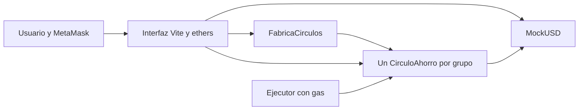

# La Junta — Guía del desarrollador

Esta guía describe la implementación existente, su ejecución y despliegue. Para funciones y límites desde la perspectiva del participante, consultar [README.md](README.md).

## 1. Estado y tecnologías

Estado al **4 de noviembre de 2026**:

- Repositorio público: [camicaicedof/la-junta-proyecto3](https://github.com/camicaicedof/la-junta-proyecto3).
- Interfaz publicada: [la-junta-proyecto3.vercel.app](https://la-junta-proyecto3.vercel.app/), en estado de vista previa sin contratos públicos configurados.
- Contratos, demostración y pruebas comprobados en Hardhat local; 13 pruebas aprobadas en la verificación realizada.
- Despliegue en Sepolia y verificación en un explorador pendientes. No existe `frontend/public/sepolia.json` en el estado documentado.
- Publicación inicial de Vercel realizada por CLI. La conexión del repositorio para despliegues automáticos y el alojamiento periódico del keeper siguen pendientes.

| Herramienta | Versión/configuración del proyecto | Responsabilidad |
| --- | --- | --- |
| Node.js | `24.x` en `package.json` | Scripts y construcción. |
| Solidity / solc | `0.8.26` | Compilación de contratos; objetivo EVM `paris`, optimización de 200 ejecuciones. |
| OpenZeppelin Contracts | `5.0.2` | ERC20, SafeERC20 y ReentrancyGuard. |
| Hardhat | `2.28.0` | Red local, pruebas y despliegues. |
| Plugin Hardhat ethers | `3.0.8` | Integración con contratos y cuentas. |
| ethers | `6.13.5` | Interacción desde scripts y navegador. |
| Vite | `6.4.1` | Servidor de desarrollo y build estático. |
| dotenv | `16.4.7` | Configuración local del despliegue. |

Se mantiene Hardhat 2 para usar configuración CommonJS y scripts JavaScript cortos. Los ejemplos de Hardhat 3 tienen otra configuración y no deben copiarse directamente. No hay backend de aplicación, base de datos, proxy actualizable ni servicio de inversión.

## 2. Instalación

Desde una carpeta nueva:

```bash
git clone https://github.com/camicaicedof/la-junta-proyecto3.git
cd la-junta-proyecto3
npm install
npm run compile
npm test
npm run demo
```

Utilizar Node.js 24 y npm. Se incluye `pnpm-lock.yaml` para quien prefiera pnpm; npm puede generar su propio `package-lock.json`. Si se cambia de gestor en el equipo, evitar mezclar instalaciones sobre un `node_modules` previo. No publicar las dependencias ni los archivos de credenciales.

En PowerShell, `proyecto.ps1` ofrece una alternativa y detecta el Node/pnpm del entorno Codex cuando npm no está en PATH:

```powershell
.\proyecto.ps1 install
.\proyecto.ps1 compile
.\proyecto.ps1 test
.\proyecto.ps1 demo
```

El script PowerShell admite `install`, `compile`, `test`, `node`, `deploy:local`, `deploy:sepolia`, `demo`, `dev`, `build`, `keeper:local` y `keeper:sepolia`. Para `setup:sepolia` y `build:cloud`, usar npm o los comandos Node indicados más adelante. Si PowerShell bloquea el script, utilizar npm o Node directamente sin cambiar la política del sistema.

### Comandos disponibles

| Comando npm | Resultado |
| --- | --- |
| `npm run compile` | Compila los contratos. |
| `npm test` | Ejecuta las pruebas en una red efímera independiente. |
| `npm run demo` | Demuestra tres rondas con una mora y retira todos los saldos. |
| `npm run node` | Mantiene una red local en el puerto 8545. |
| `npm run deploy:local` | Despliega token y fábrica en ese nodo local. |
| `npm run dev` | Sirve la interfaz en el primer puerto libre desde 5173. |
| `npm run setup:sepolia` | Prepara o consulta la billetera de pruebas y verifica su saldo y red. |
| `npm run deploy:sepolia` | Despliega token y fábrica en Sepolia. |
| `npm run build` | Construye la interfaz con la configuración local disponible. |
| `npm run build:cloud` | Construye para publicación con configuración de Sepolia, si existe. |
| `npm run keeper:local` | Procesa los círculos locales una vez y sale. |
| `npm run keeper:sepolia` | Procesa los círculos de Sepolia una vez y sale. |

## 3. Ejecutar en local

Abrir tres terminales en la raíz del repositorio.

**Terminal 1 — nodo:**

```bash
npm run node
```

**Terminal 2 — contratos:**

```bash
npm run deploy:local
```

**Terminal 3 — interfaz:**

```bash
npm run dev
```

Abrir la URL que imprime Vite, normalmente `http://127.0.0.1:5173`. Mantener el nodo y Vite encendidos durante la demostración.

Configurar MetaMask:

| Campo | Valor local |
| --- | --- |
| Nombre | Hardhat local |
| RPC | `http://127.0.0.1:8545` |
| Chain ID | `31337` |
| Moneda del gas | `ETH` |

Importar tres de las cuentas que imprime Hardhat. Sus claves son conocidas públicamente y se usan exclusivamente en el nodo local. Cada cuenta tiene ETH ficticio para gas. Desde cada una, solicitar mUSD con el faucet de la interfaz.

Reiniciar el nodo borra contratos, círculos, aportes y saldos. Volver a ejecutar el despliegue y recargar la interfaz. Si MetaMask conserva nonces del nodo anterior, restablecer su actividad para esa red de pruebas. `npm test` y `npm run demo` utilizan una red efímera diferente: no crean círculos visibles en el nodo persistente.

### Demostración sugerida

1. Preparar tres cuentas con mUSD. Crear un círculo con cuota 100, tres participantes, periodo 120 segundos, multa 5%, rendimiento 1%, modalidad por turnos y orden de inscripción.
2. Con el creador, financiar 55,35 mUSD de reserva. Cada participante deposita 315 mUSD de garantía. La última inscripción inicia el ciclo.
3. Aportar 100 mUSD por cuenta antes de cada plazo y liquidar al vencer. Un periodo completo empieza cuando se liquida el anterior.
4. Después de que una cuenta reciba su turno, omitir una de sus cuotas siguientes. Comprobar la mora, el descuento de 105 mUSD y los premios de quienes sí pagaron.
5. Terminar los tres periodos y retirar saldos. Repetir en otro círculo con modalidad al cierre o sorteo si se quiere demostrar esas opciones.

## 4. Arquitectura y archivos



| Archivo/directorio | Qué contiene |
| --- | --- |
| `contracts/MockUSD.sol` | Token ERC20 de seis decimales. `faucet()` crea 100.000 mUSD por llamada sin límite por cuenta. |
| `contracts/FabricaCirculos.sol` | Despliega contratos, fija al llamador como creador y registra sus direcciones. |
| `contracts/CirculoAhorro.sol` | Parámetros, estados, garantías, cuotas, sorteo, premios y retiros. |
| `frontend/index.html` | Formulario, botones, tabla de participantes y textos. |
| `frontend/src/main.js` | MetaMask, lectura de contratos, autorizaciones ERC20 y envío de transacciones. |
| `frontend/src/style.css` | Estilos y adaptación a pantallas pequeñas. |
| `scripts/deploy.js` | Despliegue y exportación de direcciones y ABI. |
| `scripts/setup-sepolia.js` | Generación o consulta de una billetera de pruebas en `.env`. |
| `scripts/demo.js` | Demostración reproducible sin navegador; avanza el tiempo del nodo efímero. |
| `scripts/keeper.js` | Una pasada de liquidación, cancelación y desembolso. |
| `scripts/build-cloud.js` | Build que evita publicar direcciones del nodo local. |
| `scripts/hardhat.js` | Adaptador para mantener configuración y cache de Hardhat dentro de `.local/` en Windows. |
| `hardhat.config.js` | Compilador instalado, optimización, red local y Sepolia. |
| `test/CirculoAhorro.test.js` | Pruebas de negocio, restricciones y conservación de tokens. |
| `vercel.json` / `.vercelignore` | Construcción, directorio público y exclusiones para Vercel. |
| `proyecto.ps1` | Alternativa de comandos para PowerShell. |

### Contratos y permisos

La fábrica utiliza un token fijo, recibido en su constructor. El despliegue actual crea su propio MockUSD y se lo asigna a la fábrica. Cada círculo nuevo tiene condiciones inmutables y su propio saldo; no utiliza un proxy ni comparte la contabilidad con otros círculos.

La inscripción es pública: no hay invitaciones, lista de direcciones permitidas ni aprobación individual del creador. El límite por billetera no evita que una misma persona use varias cuentas.

| Operación de `CirculoAhorro` | Quién puede ejecutarla | Condición principal |
| --- | --- | --- |
| `financiarRendimientos(monto)` | Creador | Inscripción o revelación; monto positivo. |
| `inscribirse(hashSecreto)` | Billetera con tokens y autorización | Inscripción abierta, cupo y sin inscripción previa. |
| `revelar(secreto)` | Miembro que no haya revelado | Etapa de revelación, antes del plazo y hash correcto. |
| `aportar()` | Miembro | Ciclo activo, antes del vencimiento y sin pago en esa ronda. |
| `cerrarRonda()` | Cualquier cuenta | Ciclo activo y plazo vencido. |
| `cancelarPorPlazo()` | Cualquier cuenta | Inscripción o revelación vencida sin iniciar el ciclo. |
| `retirar()` | Titular del saldo | Saldo positivo. |
| `retirarPara(miembro)` | Cualquier cuenta | Saldo positivo del miembro; el destino siempre es ese miembro. |

Para cuotas, garantías y reserva, el token requiere `approve(direccionCirculo, monto)` antes de `transferFrom`. La interfaz solicita autorización solo si la disponible no alcanza y utiliza el monto de la operación. El creador no puede cambiar parámetros, retirar garantías ajenas ni cancelar un ciclo activo.

## 5. Estados y flujo del contrato

| Estado | Valor | Comportamiento |
| --- | --- | --- |
| `Inscripcion` | 0 | Se financia la reserva y se depositan garantías. |
| `Revelacion` | 1 | Solo si hay sorteo: los miembros revelan sus semillas. |
| `Activo` | 2 | Se aportan y liquidan las `N` rondas. |
| `Finalizado` | 3 | Capital, premios, garantías restantes y reserva sobrante quedan asignados para retiro. |
| `Cancelado` | 4 | Se asignan para devolución las garantías y la reserva. |

Flujos normales: `Inscripcion → Activo → Finalizado`, o `Inscripcion → Revelacion → Activo → Finalizado`. La cancelación por plazo solo existe antes de estar activo.

Sin sorteo, la última inscripción llama a `_iniciar()`. Si falta reserva, revierte esa inscripción completa. Con sorteo, la última inscripción abre la revelación y la última revelación intenta iniciar; si falta reserva, revierte esa revelación. El creador puede financiar durante ambas etapas y luego se reintenta la operación que faltó.

Al iniciar se fija el orden y el vencimiento del primer periodo. Las rondas se numeran desde cero en el contrato. Se acepta un aporte cuando `block.timestamp < vencimiento`; se puede liquidar desde `block.timestamp >= vencimiento`. No se adelanta una liquidación porque todos hayan pagado.

`cerrarRonda()` recorre los miembros, cubre faltantes, aplica multas y distribuye premios. Después asigna el fondo del turno o lo acumula para el cierre. La última ronda devuelve las garantías restantes y el sobrante de reserva como saldos retirables. Si quedan rondas, el próximo vencimiento es el momento de liquidación más la duración del periodo; una liquidación tardía desplaza el calendario.

## 6. Reglas económicas y contabilidad

Todas las cantidades del contrato son enteros en unidades mínimas de mUSD. `1 mUSD = 1.000.000` unidades. Usar `ethers.parseUnits(valor, 6)` y `ethers.formatUnits(valor, 6)`; no operar cantidades monetarias en JavaScript con coma flotante.

Para tasas se utilizan puntos básicos: `100 bps = 1%`, `500 bps = 5%`. Hay `N` participantes y exactamente `N` rondas. Sean `Q` la cuota, `multaBps` la multa porcentual y `tasaBps` el rendimiento simulado por periodo:

```text
M = floor(Q × multaBps / 10.000)
G = N × (Q + M)                         garantía inicial por participante
fondoRonda = N × Q
maxCapital = N × G + N² × Q
reservaMinima = N × floor(maxCapital × tasaBps / 10.000)
```

La reserva es una cota conservadora, suficiente para los rendimientos del ciclo. La garantía cubre todas las cuotas y multas incluso si nadie vuelve a aportar. Con cada pago puntual entra `Q` adicional y la garantía permanece igual. Con cada incumplimiento, la garantía baja en `Q + M`.

La contabilidad separa:

| Variable | Incluye |
| --- | --- |
| `capitalBloqueado` | Garantías restantes y capital de cuotas todavía no adjudicado. |
| `reservaRendimientos` | Tokens disponibles para rendimiento, redondeos y premios sin destinatarios puntuales. |
| `saldoRetirable[cuenta]` | Tokens ya asignados a una cuenta, aunque sigan físicamente en el contrato. |
| `ahorroAcumulado` | Capital de cuotas acumulado en modalidad al cierre; es parte de `capitalBloqueado`, no un saldo adicional. |

Cuando hay mora, la cuota pasa de garantía a aporte sin entrar dinero nuevo. Por eso `capitalBloqueado` baja solo en la multa. Después de procesar todas las moras y antes de adjudicar el fondo se calcula:

```text
R = floor(capitalBloqueado × tasaBps / 10.000)
premio = sumaDeMultas + R
premioPorPuntual = floor(premio / cantidadDePuntuales)
```

El rendimiento se descuenta de la reserva; no se acuña desde el círculo ni proviene de inversiones externas. No se calcula por segundos ni representa una tasa anual. El resto de redondeo vuelve a reserva. Si no hay puntuales, todo el premio vuelve a reserva; su sobrante final corresponde al creador.

En modalidad `Turnos = 0`, `orden[ronda]` recibe `N × Q` como saldo retirable y ese monto sale de `capitalBloqueado`. En modalidad `Cierre = 1`, se acumula el fondo; al finalizar, cada miembro recibe `ahorroAcumulado / N = N × Q`. Los premios pueden retirarse por periodo en ambas modalidades.

Invariante esperado, si solo se usan las funciones previstas:

```text
saldoTokenDelCirculo = capitalBloqueado + reservaRendimientos + sumaDeSaldosRetirables
```

El saldo debe quedar en cero tras retirar todo. Una transferencia directa de tokens al contrato no crea derechos de retiro y rompe esa igualdad contable; no existe función de rescate. El prototipo usa su MockUSD estándar y no está preparado para tokens con comisiones de transferencia, rebases u otras conductas especiales.

## 7. Sorteo y semillas

1. Antes de inscribirse, cada miembro genera un secreto aleatorio de 32 bytes.
2. Registra `keccak256(abi.encode(secreto, billetera, direccionCirculo, chainId))`. No utilizar `abi.encodePacked` para reproducir ese compromiso.
3. Cuando todos están inscritos, se abre el plazo de revelación.
4. Cada miembro revela el secreto. El contrato verifica el hash y combina los secretos con XOR, sin depender del orden de revelación.
5. Fisher-Yates recorre el arreglo desde `N-1` hasta `1`. En cada paso calcula `j = uint256(keccak256(abi.encode(semillaFinal, i))) % (i+1)` e intercambia las posiciones `i` y `j`.

Los eventos `Inscrito`, `Revelado` e `Iniciado`, las funciones de consulta y `semillaFinal` permiten reconstruir el cálculo. Una prueba reproduce la permutación fuera del contrato.

**Límite del mecanismo:** el último revelador puede prever el resultado y abstenerse de revelar. Eso fuerza una cancelación selectiva y permite intentar otro círculo. No se penaliza esa abstención y no se usa VRF; no presentar el mecanismo como aleatoriedad imparcial resistente a adversarios. Tras vencer el plazo, cualquiera puede cancelar y recuperar los depósitos mediante los retiros previstos.

La interfaz guarda el secreto en `localStorage`, con una clave por red, círculo y cuenta. Hay un campo para copiarlo o restaurarlo. Borrar los datos del navegador puede perderlo. Es un secreto temporal del sorteo, distinto de la clave privada o frase de recuperación de la billetera, y se hace público al revelar.

## 8. Funcionamiento de la interfaz

`frontend/src/main.js` utiliza `ethers.BrowserProvider(window.ethereum)` y el firmante que entrega MetaMask. No recibe claves privadas. Carga ABI y direcciones desde `/deployment.json`, comprueba el chain ID y verifica que exista código en la dirección de la fábrica al conectar.

Las funciones principales son `connect()` para conectar, `loadCircles()` para consultar la fábrica, `renderCircle()` para consultar estados y habilitar botones, `approve()` para autorizaciones y `tx()` para esperar confirmaciones. `run()` bloquea acciones simultáneas y actualiza la vista al terminar. Un error o rechazo de MetaMask se muestra en el aviso de estado.

La página consulta el círculo aproximadamente cada 12 segundos y permite actualizar manualmente. Los plazos se comparan con el timestamp del último bloque; la fecha se muestra en la hora local del navegador. Los cambios de cuenta o cadena recargan la página. No existe indexador ni historial completo de eventos en la interfaz: los datos mostrados provienen de lecturas directas del contrato.

## 9. Desplegar contratos en Sepolia

### Configurar la cuenta

Se requiere un RPC de Sepolia y una cuenta de pruebas con ETH de Sepolia para gas. El archivo `.env` usa `SEPOLIA_RPC_URL` y `PRIVATE_KEY`. La configuración de Hardhat carga `.env`; no confundirlo con `.env.local`, que puede crear Vercel.

**En el equipo donde se preparó el proyecto ya existe `.env`. No sobrescribirlo.** En un clon nuevo se puede generar una cuenta exclusiva:

```bash
npm run setup:sepolia
# Si npm no está disponible:
node scripts/setup-sepolia.js
```

El helper conserva la cuenta si ya hay una clave configurada, muestra solo dirección y saldo, y comprueba que el chain ID sea `11155111`. Si no hay clave, genera una nueva y la guarda en `.env`. Si se configura una cuenta propia manualmente, incluir también un RPC válido. No subir `.env` ni copiar claves en chats o documentación.

La dirección pública preparada en el equipo de desarrollo es `0x93dbb3267dcE724Ad22083Cfe19e9FCDFcc31081`. Un clon genera otra cuenta; no se incluye la clave en el repositorio. El último saldo consultado durante la preparación fue cero: comprobarlo de nuevo con el helper antes del despliegue.

Solicitar ETH de Sepolia en un faucet, por ejemplo el [faucet de Google Cloud](https://cloud.google.com/application/web3/faucet/ethereum/sepolia), y enviarlo a la cuenta que muestre el helper. No enviar ETH de mainnet ni dinero real.

### Ejecutar el despliegue

```bash
npm run compile
npm run deploy:sepolia
```

`deploy.js` despliega **un nuevo MockUSD y una nueva fábrica**. Los círculos se crean después desde la aplicación. Espera la confirmación de cada contrato y exporta ABI y direcciones:

| Archivo generado | Uso | ¿Se sube a Git? |
| --- | --- | --- |
| `deployments/localhost.json` o `deployments/sepolia.json` | Scripts locales y keeper de esa red. | No. |
| `frontend/public/deployment.json` | Configuración del último despliegue para desarrollo local. | No. |
| `frontend/public/sepolia.json` | Configuración pública de Sepolia para construir el sitio compartido. | Sí, después de un despliegue correcto. |

Cada nueva ejecución cambia el token y la fábrica a los que apunta la interfaz. Los contratos anteriores permanecen en la cadena y sus fondos no se migran. No redesplegar como mecanismo de actualización de círculos activos; conservar sus direcciones. Si falla una ejecución después de desplegar el primer contrato, puede haber un despliegue parcial sin exportación final: revisar la transacción antes de reintentar.

Tras desplegar, conectar MetaMask a Sepolia, comprobar las direcciones exportadas y probar una operación desde una cuenta con gas y mUSD. La verificación del código fuente en un explorador no está configurada en los scripts actuales.

## 10. Construir y publicar la interfaz

### Diferencia entre los builds

`npm run build` ejecuta Vite y genera `frontend/dist` con los recursos públicos disponibles, incluida una posible configuración local. Se usa para inspección local; no es el comando recomendado para compartir el proyecto.

```bash
npm run build:cloud
# Alternativa sin npm:
node scripts/build-cloud.js
```

El build de nube lee `frontend/public/sepolia.json`, verifica chain ID, formato de direcciones y presencia de ABI, construye con Vite y coloca esa configuración en `frontend/dist/deployment.json`. Esa validación no comprueba por sí sola que los contratos existan o sean los esperados: verificarlo también en la red.

Si no existe configuración de Sepolia, elimina del resultado cualquier `deployment.json` local. Así puede publicarse una vista previa, con operaciones deshabilitadas y aviso del paso pendiente. Si la configuración existe pero es inválida, el build falla. El directorio fuente `frontend/public/deployment.json` no se modifica.

### Vercel

El proyecto existente se llama `la-junta-proyecto3`, en el espacio `tecnologias-emergentes`. El repositorio contiene:

| Opción de `vercel.json` | Valor |
| --- | --- |
| Framework | `vite` |
| Instalación | `npm install --include=dev` |
| Build | `npm run build:cloud` |
| Salida | `frontend/dist` |
| Cache de `/deployment.json` | `no-store` |

No hace falta subir `PRIVATE_KEY` a Vercel: los contratos se despliegan por separado y la interfaz obtiene firmas desde MetaMask. `.vercelignore` excluye los archivos de credenciales, dependencias y datos locales.

Para publicar mediante CLI, instalar la herramienta oficial de Vercel e iniciar sesión en la cuenta correcta:

```bash
npm install --global vercel
vercel login
vercel link --yes --scope tecnologias-emergentes --project la-junta-proyecto3
vercel project inspect --non-interactive --scope tecnologias-emergentes
vercel deploy --prod --skip-domain --scope tecnologias-emergentes
```

Para otro equipo o cuenta, sustituir el espacio y el nombre por los que correspondan; no crear otro proyecto si se va a mantener el existente. La inspección debe mostrar el destino esperado antes de publicar.

El último comando construye una versión de producción sin asignarle todavía el dominio principal. Comprobar su URL y luego promover esa misma versión:

```bash
vercel curl / --deployment URL_DEVUELTA --scope tecnologias-emergentes
vercel promote URL_DEVUELTA --scope tecnologias-emergentes
```

Reemplazar `URL_DEVUELTA` por la URL real del despliegue. `vercel curl` puede acceder con la sesión de Vercel; comprobar también el dominio principal en una ventana sin sesión para confirmar que se puede compartir.

Después del despliegue de Sepolia, subir la configuración pública y publicar de nuevo:

```bash
git add frontend/public/sepolia.json
git commit -m "Configurar contratos de Sepolia"
git push origin main
```

**Por ahora un `git push` no publica automáticamente en Vercel.** Se intentó conectar el repositorio y faltó acceso. Para habilitarlo, autorizar la integración de GitHub desde Vercel para este repositorio y comprobar un despliegue por commit. Mientras tanto, utilizar la CLI. No publicar `.env`, `.env.local` ni credenciales generadas por las herramientas.

## 11. Ejecutor o keeper

```bash
npm run keeper:local
# O, después del despliegue público:
npm run keeper:sepolia
```

El script carga `deployments/<red>.json`, consulta la fábrica y recorre todos sus círculos. Si una ronda está vencida, la cierra. Si venció una inscripción o revelación sin iniciar, cancela. Después envía los saldos disponibles a los miembros y al creador usando `retirarPara`. Cada transacción requiere gas del firmante del script; ese firmante no puede cambiar el destino de los saldos.

Es **una pasada**, no un proceso permanente. Para continuidad hay que ejecutarlo periódicamente con un programador de tareas o servicio externo. Se necesita acceso al RPC, configuración de esa fábrica y una cuenta de pruebas financiada. Si se ejecuta en otra máquina, copiar de forma segura la configuración de despliegue y configurar sus credenciales; no depender de archivos ignorados que no vienen en el clon.

Los errores por círculo se registran y el script continúa con los siguientes, terminando con código de error si hubo fallos. No hay reintentos ni monitorización configurados. Si una transferencia falla dentro de un círculo, las operaciones pendientes de ese círculo se retoman en una pasada posterior. Los círculos no se ejecutan solos aunque nadie abra la página.

## 12. Pruebas y validación

`test/CirculoAhorro.test.js` contiene 13 casos. Se comprueban turnos, reparto al cierre, abandono después de recibir turno, todos morosos, distintas combinaciones de incumplimiento, conservación de tokens, restricciones de pago/plazos, financiación de reserva, cancelaciones, reproducción del sorteo, retiros, fábrica y desembolso por terceros sin redirigir fondos.

`npm run demo` ejecuta tres rondas con tres cuentas. Bruno deja de pagar la última, después de haber recibido el segundo turno. Al retirar todos los saldos, la salida debe terminar con `Saldo final del contrato: 0`.

Validación realizada durante la implementación: compilación de contratos, 13 pruebas aprobadas, demo con saldo final cero, despliegue local, build estático y publicación de la página en Vercel con HTTP 200 sin sesión. El navegador de revisión no tenía MetaMask, por lo que no se validó un recorrido completo de la extensión. Tampoco se validaron transacciones en Sepolia ni un keeper alojado de forma permanente. No hay auditoría externa ni pruebas específicas de tokens maliciosos o reentrada.

Para cambios en contratos, ejecutar compilación, pruebas y demo; revisar contabilidad, permisos, límites y cancelaciones. Para cambios de interfaz, comprobar el build y el recorrido afectado con MetaMask. Para documentación solamente, revisar enlaces, comandos y correspondencia con el código; no hace falta redesplegar los contratos.

## 13. Errores frecuentes

| Síntoma | Revisar o resolver |
| --- | --- |
| Página pública con botones deshabilitados | Falta `sepolia.json`, el build fue una vista previa o no se publicó el build nuevo. |
| Página local sin configuración | Arrancar el nodo y ejecutar `deploy:local`; recargar. |
| MetaMask en otra red | Usar el chain ID que exige `deployment.json`: 31337 local o 11155111 Sepolia. |
| No hay código en la fábrica | Nodo reiniciado, dirección antigua o red equivocada; revisar antes de volver a desplegar. |
| No alcanza ETH para transacciones | Financiar con gas de la misma red de pruebas; mUSD no paga gas. |
| Depósito rechazado | Revisar saldo de mUSD y autorización `approve` al círculo, no a la fábrica. |
| `Financiar reserva primero` | El creador debe cubrir `reservaNecesaria()` antes de completar el inicio. |
| `Aun no vence` o `Periodo cerrado` | Revisar timestamp de cadena y ronda; no se aceptan aportes tardíos. |
| `Secreto incorrecto` | Restaurar la semilla exacta para esa cuenta, círculo y red. |
| `No cancelable` | Solo hay cancelación por plazo antes de activar el círculo. |
| `Sin saldo` | Ya se retiró, no se adjudicó todavía o se está usando otra cuenta. |
| Errores de nonce después de reiniciar Hardhat | Restablecer actividad de la cuenta en la red local y redesplegar. |
| `npm` no aparece en PowerShell | Instalar Node.js con npm o utilizar los comandos admitidos por `proyecto.ps1`. |
| Keeper sin archivo de despliegue | Recuperar `deployments/<red>.json` de la ejecución correspondiente; no inventar direcciones ni redesplegar si hay círculos activos. |
| GitHub actualizado y web sin cambios | La integración automática sigue pendiente; publicar desde Vercel CLI. |
| Vercel o Git pide iniciar sesión | Completar el acceso en la cuenta correcta; no pegar tokens en comandos, chats ni archivos públicos. |

## 14. Criterios para ampliar el proyecto

Las reglas actuales priorizan una demostración explicable. Antes de una versión con fondos reales harían falta revisión de seguridad, una decisión sobre garantías económicamente útiles, aleatoriedad verificable con gestión de fallos, un mecanismo real de rendimientos y compatibilidad probada con el activo elegido. La identidad, reputación entre círculos, indexación de eventos, historial de transacciones, notificaciones y operación del keeper son funciones todavía por desarrollar.

Las garantías completas evitan insolvencia dentro del modelo de prueba, pero no constituyen crédito sin colateral. Las billeteras son públicas y no identifican personas. El token de prueba no protege frente a inflación ni acredita respaldo en dólares. Mantener estas limitaciones visibles en la documentación del usuario si se amplía la implementación.

## Referencias

- [OpenZeppelin Contracts 5.x](https://docs.openzeppelin.com/contracts/5.x/).
- [Hardhat 2](https://v2.hardhat.org/hardhat-runner/docs/getting-started).
- [Vite: despliegue estático](https://vite.dev/guide/static-deploy.html).
- [Vercel: configuración del proyecto](https://vercel.com/docs/project-configuration).
- [Contexto académico de Berkeley Haas](https://haas.berkeley.edu/ibsi/research/good-reputation-expanding-access-to-credit-leveraging-reputational-and-social-network-data/).
